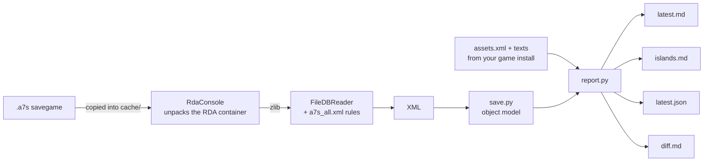

<h1 align="center">anno1800-save-report</h1>

<p align="center">
  <b>Turn an Anno 1800 savegame into a plain-text report of your whole game.</b><br>
  An AI assistant reads the report and gives advice, so you do not have to send screenshots.
</p>

<p align="center">
  <a href="https://github.com/dgahagan/anno1800-save-report/actions/workflows/ci.yml"></a>
  <a href="LICENSE"></a>
  
  
  
</p>

<p align="center">
  <a href="#quick-start">Quick start</a> ·
  <a href="#what-you-get">What you get</a> ·
  <a href="#use-with-claude-code">Use with Claude Code</a> ·
  <a href="#known-limits">Known limits</a> ·
  <a href="#how-it-works">How it works</a>
</p>

---

`anno-report` decodes the newest save and writes the game state as Markdown and JSON: treasury, population, problems, every island, trade routes, ships and diplomacy. The report is made for an AI assistant such as [Claude Code](https://claude.com/claude-code), and it is also readable on its own.

- **Problems first.** Idle factories, game warning icons, unmet needs and goods that will run out soon come at the top.
- **Every island.** Population, workforce balance, needs, production, stock and stock trends for each island you own.
- **Settling help.** Fertilities, deposits and distances for every island in every session, including unclaimed ones.
- **History.** Each run archives saves it has not seen, so you can diff against the previous save or build a trend table, even after the game rotates its autosaves away.
- **Safe.** It only reads your saves and game install. It never writes to the game's folders.

Not affiliated with Ubisoft.

## Quick start

```bash
git clone https://github.com/dgahagan/anno1800-save-report.git
cd anno1800-save-report
scripts/setup_tools.sh                                       # builds the two decoders into vendor/
python3 -m venv .venv && .venv/bin/pip install -e ".[dev]"
./anno-report                                                # reports the newest save → reports/latest.md
```

Read [Requirements](#requirements) and [Setup](#setup) for the details.

## Status

- Works on Linux with the Steam version under Proton. Other setups need the path overrides below and are untested.
- Tested with game build 1412158, on base-game saves with the Old World and the New World.
- **DLC:** population tiers, workforce and sessions from every DLC are read from the game data, so they should appear in the report. No save with DLC content has been tested yet. DLC-only systems (electricity, research, docklands, tourists, airships and the rest) have no report section.
- Several numbers are estimates. Read [Known limits](#known-limits) before you trust the finance line.

## What you get

`./anno-report` writes four files into `reports/`:

- `latest.md` — the main report. Problems come first.
- `islands.md` — every island in every session: owner, fertilities, deposits, distance to the session exit and to the nearest pirate harbour. Unclaimed islands are included, so it helps you choose where to settle.
- `latest.json` — the same data as raw numbers.
- `diff.md` — what changed since the previous save.

An excerpt of `latest.md` (names invented):

```markdown
# Anno 1800 state report — Autosave 12.a7s
Saved 2026-11-01 01:10 · game time 4h41m · build 1412158 · decode 42s · sha 0a1b2c3d

**Company:** Example Trading Co. · **Treasury:** 82,231 coins · **Population:** 5,950
**DLC active in this save:** none
**Population by tier:** Farmers 2,188, Workers 1,959, Artisans 962, Jornaleros 660, Obreros 181
**Estimated finances (per minute):** tax income 13,679 · building upkeep 8,748 · ship upkeep 420 · balance +4,511  _(upper bound; the game's finance screen has shown less)_

## Problems first
- Northaven: low productivity at Coal Mine x2, Grain Farm, Furnace.
- Northaven: game warnings: Full Output Storage at Grain Farm x2; Missing Goods at Cannery; No Warehouse in Range at Furnace.
- Northaven: Artisans get no Fur Coats (37 houses; the need is unlocked, so it ran dry or is switched off).
- Northaven: Clay stock fell 47 → 8 in 20 min; empty in about 4 min at this rate.

## Your islands
### Northaven (The Old World)
- Population: Farmers 1,692, Workers 1,959, Artisans 962
- Workforce: Farmers 1692/1505 needed, Workers 1959/1805 needed, Artisans 962/500 needed
- Needs (supply): Market 100%, Pub 100%, Fish 100%, Schnapps 100%, Work Clothes 100%, Bread 100%, Beer 100%
- Production: Bakery x3 @100%; Brewery x4 @100%; Cannery x1 @60%; Coal Mine x2 @8% (2 under 50%); Fishery x5 @90%
- Stock now, as `stock (change over the last 20 min)`: Beer 44 (+30), Bread 40 (+1), Bricks 194 (+29), Clay 8 (-39)
```

## Requirements

- Linux, with Anno 1800 installed through Steam (native or Flatpak)
- Python 3.11 or newer
- .NET SDK (any current version; the setup script retargets the tools to it)
- git
- Disk space:

  | what | where | size |
  |---|---|---|
  | built decoders | `vendor/` | about 260 MB |
  | Python venv | `.venv/` | about 110 MB |
  | extracted game data | `cache/gamedata/` | about 300 MB |
  | each decoded save | `cache/<sha1>/` | about 180 MB; trim with `--prune-cache N` |
  | archived saves | `archive/<profile>/` | about 1.5–2 MB per save |

## Setup

```bash
git clone https://github.com/dgahagan/anno1800-save-report.git
cd anno1800-save-report
scripts/setup_tools.sh                                   # clones and builds the two decoders into vendor/
python3 -m venv .venv && .venv/bin/pip install -e ".[dev]"
./anno-report                                            # newest save; about 1 min, then a few seconds when cached
```

The first run takes about 2–3 minutes. It extracts the game's asset list once. It also copies every save of the profile into `archive/` (128 saves came to 191 MB in one test). Use `--no-archive` to skip that.

## Use

```bash
./anno-report                          # newest save of the default profile
./anno-report --profile "My Company"   # a profile by its folder name
./anno-report --save path/to/file.a7s  # one specific save
./anno-report --trend 5                # add a trend table over the last 5 saves
./anno-report --prune-cache 5          # keep only the 5 newest decoded saves
```

The game rotates its autosaves away. Each run therefore copies saves it has not seen into `archive/<profile>/`. `--no-archive` turns that off.

### Paths

Save and game paths are found from the Steam/Proton prefix. Every Steam library in `libraryfolders.vdf` is searched, so a game on a second drive is found. To override, create `config.local.toml`:

```toml
profile = "My Company"
savegame_root = "~/.local/share/Steam/steamapps/compatdata/916440/pfx/drive_c/users/steamuser/Documents/Anno 1800"
game_maindata = "~/.local/share/Steam/steamapps/common/Anno 1800/maindata"
```

`savegame_root` is the folder that holds `accounts/<account-id>/<profile>/*.a7s`.

### Keeping your data apart from the code

`archive/`, `cache/`, `reports/`, `notes/` and `config.local.toml` are your data. They are gitignored here. To keep them in another folder, for example a private repo of your own, set `ANNO_REPORT_HOME`:

```bash
ANNO_REPORT_HOME=~/my-anno-game ./anno-report
```

The built tools in `vendor/` always stay with the code.

## Use with Claude Code

`CLAUDE.md` tells Claude how to run the tool and how to keep notes on your game. Start it once:

```bash
cp -r notes.example notes     # then fill in notes/player.md: your experience, which DLC you own, how you want advice
```

Then open Claude Code in this folder (or in your `ANNO_REPORT_HOME` folder with a copy of `CLAUDE.md`), save the game, and ask your question.

A typical session:

```text
you    › I just saved. Why is my income dropping?
claude   runs ./anno-report, reads reports/latest.md and reports/diff.md
claude › Your balance fell by about 600/min since the last save. Two causes:
         1. Northaven: 2 Coal Mines run at 8% because the Furnaces have no warehouse in range.
         2. Artisans get no Fur Coats (37 houses), so they pay less tax.
         Fix the warehouse first. It also unblocks Steel.
claude   updates notes/game-state.md and adds the decision to notes/journal.md
```

The notes in `notes/` carry your game from one session to the next:

| file | holds |
|---|---|
| `player.md` | your experience, which DLC you own, how you want advice |
| `game-state.md` | a summary of the current game, rewritten after each session |
| `journal.md` | dated decisions |
| `todo.md` | the in-game checklist |

## Privacy

A savegame contains your Ubisoft account id and your company name. Do not attach `.a7s` files or decoded XML to a public issue. The `.gitignore` here keeps saves, notes and reports out of git.

## Known limits

- **Finances are an estimate:** residence tax minus building upkeep minus ship upkeep. It has run several hundred coins per minute above the game's finance screen. Treat it as an upper bound. The save holds no finance figure for the human player.
- Ships that are crossing between sessions are in no session and are missing from the Ships table.
- The distance to the session exit is known for the New World only.
- "Needs unlocked but not consumed" cannot tell "ran dry" from "switched off".
- Diplomacy states 2 (trade rights) and 3 (alliance) are guesses. So are the incident types other than fire.
- A game patch can change the save format.

[`docs/save-format.md`](docs/save-format.md) records what is known about the format and what is still open.

## How it works



Names, needs, upkeep and population tiers come from `assets.xml` and `texts_english.xml`, extracted once from the highest-numbered `maindata/data*.rda` of your own game install. No game data ships with this repo.

## Tests

```bash
.venv/bin/pytest -rs
```

`tests/test_units.py` needs only Python. CI runs these. `tests/test_report.py` decodes real saves, so it needs the built tools, the game install and a save. Because saves are private, none ship here: copy `tests/fixtures.example.toml` to `tests/fixtures.local.toml` and list your own. When a save, the tools or the game is missing, those tests skip. They do not fail.

## Third-party tools

`scripts/setup_tools.sh` clones these at fixed commits and builds them on your machine. Their source and binaries are not part of this repo.

| tool | use | licence | commit |
|---|---|---|---|
| [anno-mods/RdaConsole](https://github.com/anno-mods/RdaConsole) | unpacks the RDA container | none declared | `97ec11e98394bf1a4ee2c478b91271e6e066731b` (2024-11-28) |
| [anno-mods/FileDBReader](https://github.com/anno-mods/FileDBReader) | decodes FileDB blobs to XML | none declared | `fae10393e29e095e338dfdd3596663616311c5d8` (2026-10-15) |
| [NiHoel/Anno1800SavegameVisualizer](https://github.com/NiHoel/Anno1800SavegameVisualizer) | supplies the `a7s_all.xml` rule file | MIT | `bb40bfcb38e8426e2aed0079561cdcdf894fd356` (2024-04-06) |

The two anno-mods tools declare no licence. That is why this project builds them from source at setup and does not redistribute them.

## Contributing

Checks against the game, DLC saves and decoded fields are the most useful help. Read [CONTRIBUTING.md](CONTRIBUTING.md).

## Licence

MIT. See [LICENSE](LICENSE). Anno 1800 is a trademark of Ubisoft Entertainment.
